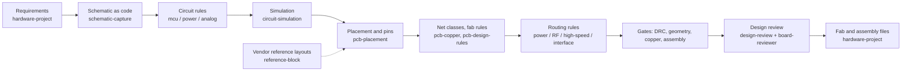

# claude-hardware-skills

[](https://github.com/gabrielfrasantos/claude-hardware-skills/actions/workflows/ci.yml)
[](https://github.com/gabrielfrasantos/claude-hardware-skills/releases)
[](LICENSE)


Claude Code skills and tools for designing electronics in **KiCad 10**, from the firmware's requirements to the fab
files. The rules come from vendor datasheets, app notes, standards and fab capability pages, each one cited. The
workflows and tools come from real boards:
[e-inverted-pendulum](https://github.com/embedded-pro/e-inverted-pendulum-hardware),
[e-foc](https://github.com/embedded-pro/e-foc-hardware) and
[e-psu](https://github.com/embedded-pro/e-psu-hardware).

The repository is a Claude Code **plugin marketplace** (`hardware-skills`) with one plugin (`hardware-design`).

## What it does

- **Rules an agent can follow and you can check.** Every number has a source (document ID and section), is marked
  *derived* with its arithmetic, or is labelled a rule of thumb or house style.
- **Tools, not just text.** Python scripts read and write KiCad 10 files directly. They generate the schematic,
  assign MCU pins from the placement, place parts, size net classes, set fab rules, copy vendor layouts, and gate
  the board before review. They run locally and in CI.
- **A workflow with gates.** Requirements traced to the firmware, decisions logged, phases signed off by the owner.



## Skills

### Project

| Skill | Use it to |
|---|---|
| [`hardware-project`](plugins/hardware-design/skills/hardware-project/SKILL.md) | Start and run a board repo: scaffold (CLAUDE.md, requirements traced to firmware, decisions, phase gates, reviewer agent), check traceability, and export review, BOM, JLCPCB stock (packages, lifecycle, second sources), fab, release packages and visual diffs |

### Review

| Skill | Use it to |
|---|---|
| [`design-review`](plugins/hardware-design/skills/design-review/SKILL.md) | Review any KiCad 10 schematic or PCB: one command runs every scripted check into a findings file (decoupling, pull-ups, MCU strap and power pins, voltage ratings, diode and capacitor orientation, connector ESD, divider ranges, ERC, fab and geometry gates, net classes, assembly, vendor blocks). The `board-reviewer` agent then triages each finding and checks each IC against its datasheet. A seeded-defect eval measures how much a review catches |

### Schematic and circuits

| Skill | Use it to |
|---|---|
| [`schematic-capture`](plugins/hardware-design/skills/schematic-capture/SKILL.md) | Draw the schematic as code (Python sheets to KiCad 10, deterministic), with function nets for pins chosen after placement and net-class labels; check the netlist against intent, drawing-only changes, and symbol pins against footprint pads and BOM fields |
| [`mcu-circuit-design`](plugins/hardware-design/skills/mcu-circuit-design/SKILL.md) | Design the circuitry around any microcontroller: supplies and decoupling, reset and boot, clocks, debug, GPIO and connector protection, ESD |
| [`power-circuit-design`](plugins/hardware-design/skills/power-circuit-design/SKILL.md) | Design power circuits: input protection (reverse polarity, inrush, hot plug, TVS, fuse, UVLO), buck and LDO rails, H-bridge and three-phase stages, gate drive, bus capacitors and regeneration, current sense, protection, snubbers, thermal |
| [`analog-circuit-design`](plugins/hardware-design/skills/analog-circuit-design/SKILL.md) | Design op-amp, reference, ADC-drive and sensor circuits: protection, noise, stability, component choice |
| [`circuit-simulation`](plugins/hardware-design/skills/circuit-simulation/SKILL.md) | Build an ngspice + Python suite from the schematic: loop stability, corners, transients, protection, noise, a report |

### Layout

| Skill | Use it to |
|---|---|
| [`pcb-placement`](plugins/hardware-design/skills/pcb-placement/SKILL.md) | Place the unlocked parts around the owner's locked anchors (simulated annealing on ratsnest, crossings and decoupling distance), render it, gate it against a baseline and the assembler's rules (package-pair spacing, edge keep-outs, fiducials, orientation), and assign the MCU's pins from the placement |
| [`pcb-copper`](plugins/hardware-design/skills/pcb-copper/SKILL.md) | Give every net a class from one standard set (`PWR_4A`, `GND`, `SIGNAL`, `DIFF_90`, `RF_50`, `…_48V`), size widths from the current and clearances from the voltage (IPC-2152 / IPC-2221C), and gate tracks below their class and missing pours |
| [`pcb-design-rules`](plugins/hardware-design/skills/pcb-design-rules/SKILL.md) | Set the board's rules from the fab (JLCPCB, Seeed, or both), turn teardrops on, record the stack-up, then gate shorts and clearance, DRC, geometry (house style: 45° corners, mostly horizontal and vertical tracks) and copper (pours, planes, stitching) |
| [`power-pcb-layout`](plugins/hardware-design/skills/power-pcb-layout/SKILL.md) | Lay out power stages: hot loops, gate drive, high-current copper, Kelvin sensing, thermal, isolation; following the parts you place |
| [`rf-layout`](plugins/hardware-design/skills/rf-layout/SKILL.md) | Lay out 2.4 GHz radios (BLE, 802.15.4, Wi-Fi), chip-down or module: 50 Ω lines, matching, antennas, supplies, crystals, coexistence, certification |
| [`high-speed-digital-layout`](plugins/hardware-design/skills/high-speed-digital-layout/SKILL.md) | Route memories (QSPI, SDRAM, DDR, SD/eMMC), displays (RGB, MIPI, LVDS), cameras and clocks |
| [`interface-layout`](plugins/hardware-design/skills/interface-layout/SKILL.md) | Lay out USB, USB-C, CAN, RS-485, Ethernet, isolated buses, connector ESD and shielding |
| [`reference-block`](plugins/hardware-design/skills/reference-block/SKILL.md) | Copy a vendor's proven layout block (RF corner, NFC coil, power stage) onto your board: import Altium and others with `kicad-cli`, map parts and nets, paste the copper, check it stays intact; and when copying beats designing |

## Install

### Claude Code

```
/plugin marketplace add gabrielfrasantos/claude-hardware-skills
/plugin install hardware-design@hardware-skills
```

Skills load when a task matches their description, or call one by name, e.g. `/hardware-design:pcb-placement`.
The plugin is versioned by release (`vX.Y.Z` tags, see the [changelog](CHANGELOG.md)); run
`/plugin marketplace update hardware-skills` to update, or turn on auto-update under **Marketplaces** in `/plugin`.

### For everyone working in a hardware repo

From the hardware repo's root, once, then commit the `.claude/settings.json` it writes:

```bash
claude plugin marketplace add gabrielfrasantos/claude-hardware-skills --scope project
```

Teammates who trust the folder get the marketplace registered automatically. `hardware-project`'s scaffold does this
for a new board repo.

### claude.ai

The rules-only skills (`*-layout`, `*-circuit-design`, `circuit-simulation`) are self-contained: zip the skill's
folder and upload it under skills in claude.ai's settings. The skills with tools need the whole plugin.

## Requirements for the tools

- **KiCad 10 or later** (`kicad-cli`) for DRC, ERC, netlists, imports and exports. Files older than KiCad 10 are
  refused; open and save them in KiCad 10 first.
- **Python 3.10+** with `pip install -r requirements.txt` (shapely, numpy, scipy, matplotlib).
- **ngspice** for `circuit-simulation`.
- Network access for `jlc_stock.py` (JLCPCB parts library) and `fetch_datasheet.py`.

The tests need none of KiCad, ngspice or the network.

## How it's checked

- **Sources.** Each skill ends with its references; [`docs/research/best-practices-audit.md`](docs/research/best-practices-audit.md)
  is an audit of the skills against primary sources, with what was changed.
- **Tests.** Every script has self-tests on synthetic KiCad 10 files; CI runs them, a lint and the plugin validator
  on every pull request.
- **Real boards.** The tools are measured on the boards above (placement against the owner's, schematic generation
  byte-identical, a vendor block round trip byte-identical); each skill says what was measured and what wasn't.
- **Evals.** [`evals/`](evals/README.md) runs a board repo's eval cases with and without the plugin and scores them
  against the owner's own work, and plants known defects in a real board to score a review.

## Repository layout

```
.claude-plugin/marketplace.json        marketplace "hardware-skills"
plugins/hardware-design/
├── .claude-plugin/plugin.json         plugin "hardware-design"
├── agents/board-reviewer.md           the reviewer agent (read-only)
└── skills/<skill>/                    SKILL.md, plus scripts/ and profiles/ where the skill has tools
docs/design.md                         the plan and its decisions (D1, D2, ...)
docs/research/                         audits and research notes
evals/                                 generic eval harness (the cases live in the board repos)
```

## Contributing

Corrections backed by a primary source are the most useful contribution. See [CONTRIBUTING.md](CONTRIBUTING.md) for
how rules are sourced, how scripts are tested and how commits become releases.

## License

[MIT](LICENSE). The skills cite vendor documents and standards; they don't reproduce them, and those documents stay
under their owners' terms. Vendor design files used with `reference-block` stay in your board repo's gitignored
`reference/` folder, under the vendor's licence.
