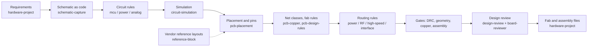

# hardware-design-skills

[](https://github.com/gabrielfrasantos/hardware-design-skills/actions/workflows/ci.yml)
[](https://github.com/gabrielfrasantos/hardware-design-skills/releases)
[](LICENSE)


**Sourced design rules and tested tools that let an AI agent design electronics in KiCad 10, from requirements to
fab files, without guessing.**

An agent asked to lay out a buck converter or pick decoupling will produce something plausible. Plausible isn't
good enough for a board: a wrong rule costs a respin. This repository gives the agent two things it lacks:

1. **Rules it can follow and you can check.** Every number cites its source (datasheet, app note, standard or fab
   capability page, by document ID and section). If a number has no source, it is marked *derived* with the
   arithmetic shown, or labelled *rule of thumb* or *house style*. Rules are vendor-neutral: they tell you which
   datasheet parameter to look up instead of copying one part family's value.
2. **Tools that work on real KiCad files.** Python scripts read and write `.kicad_sch` / `.kicad_pcb` directly and
   call `kicad-cli`. They generate the schematic, assign MCU pins, place parts, size net classes, set fab rules,
   copy vendor layouts, run gates and review the design. They run the same in an agent session, in a terminal and
   in CI.

The skills are not tied to a particular board, MCU family or vendor.

## Workflow



Each phase ends at a gate the owner signs off. Requirements are traced to the firmware, and every decision is
logged.

## Skills

| Area | Skill | What it does |
|---|---|---|
| Project | [`hardware-project`](plugins/hardware-design/skills/hardware-project/SKILL.md) | Scaffolds a board repo (requirements traced to firmware, decision log, phase plan, reviewer agent). Checks traceability. Exports the review package, BOM, JLCPCB stock check, fab files, release package and visual diffs |
| Review | [`design-review`](plugins/hardware-design/skills/design-review/SKILL.md) | Runs every scripted check on a schematic or PCB in one command: decoupling, pull-ups, straps, voltage ratings, polarity, connector ESD, ERC/DRC, fab, geometry, net classes, assembly. A read-only reviewer agent then triages the findings against the datasheets |
| Schematic | [`schematic-capture`](plugins/hardware-design/skills/schematic-capture/SKILL.md) | Writes the schematic as Python and builds it into KiCad 10 the same way every time. Checks the netlist against intent, proves that drawing-only changes leave the circuit alone, and checks symbols against footprints and BOM fields |
| Circuits | [`mcu-circuit-design`](plugins/hardware-design/skills/mcu-circuit-design/SKILL.md) | Covers everything around any MCU: supplies, decoupling, reset/boot, clocks, debug, GPIO protection, ESD |
| | [`power-circuit-design`](plugins/hardware-design/skills/power-circuit-design/SKILL.md) | Covers input protection, buck/LDO rails, H-bridge and three-phase stages, gate drive, bus capacitors, current sensing, snubbers and thermal design |
| | [`analog-circuit-design`](plugins/hardware-design/skills/analog-circuit-design/SKILL.md) | Covers op-amps, references, ADC drive and sensor front ends: protection, noise, stability |
| | [`circuit-simulation`](plugins/hardware-design/skills/circuit-simulation/SKILL.md) | Builds an ngspice + Python suite from the schematic: loop stability, corners, transients, protection, noise, and a report |
| Layout | [`pcb-placement`](plugins/hardware-design/skills/pcb-placement/SKILL.md) | Places unlocked parts around the owner's locked anchors with simulated annealing, gates the result against assembly rules, and assigns MCU pins from the placement |
| | [`pcb-copper`](plugins/hardware-design/skills/pcb-copper/SKILL.md) | Applies one standard net-class set (`PWR_4A`, `GND`, `DIFF_90`, `RF_50`, …). Sizes widths from current and clearances from voltage (IPC-2152 / IPC-2221) |
| | [`pcb-design-rules`](plugins/hardware-design/skills/pcb-design-rules/SKILL.md) | Sets board rules from fab profiles (JLCPCB, Seeed), turns on teardrops, records the stack-up, and gates shorts, clearance, geometry and copper. Keeps the silkscreen to readable references only |
| | [`power-pcb-layout`](plugins/hardware-design/skills/power-pcb-layout/SKILL.md) | Covers hot loops, gate drive, high-current copper, Kelvin sensing, thermal and isolation |
| | [`rf-layout`](plugins/hardware-design/skills/rf-layout/SKILL.md) | Covers 2.4 GHz radios (BLE, 802.15.4, Wi-Fi), chip-down or module: 50 Ω lines, matching, antennas, coexistence, certification |
| | [`high-speed-digital-layout`](plugins/hardware-design/skills/high-speed-digital-layout/SKILL.md) | Covers QSPI, SDRAM, DDR, SD/eMMC, RGB/MIPI/LVDS displays, cameras and clocks |
| | [`interface-layout`](plugins/hardware-design/skills/interface-layout/SKILL.md) | Covers USB, USB-C/PD, CAN, RS-485, Ethernet, isolated buses, connector ESD and shielding |
| | [`reference-block`](plugins/hardware-design/skills/reference-block/SKILL.md) | Copies a vendor's proven layout block (RF corner, NFC coil, power stage) onto your board, maps parts and nets, and checks the block stays intact |

## Install

The skills are packaged as a [Claude Code](https://code.claude.com) plugin marketplace (`hardware-skills`, one
plugin: `hardware-design`).

```
/plugin marketplace add gabrielfrasantos/hardware-design-skills
/plugin install hardware-design@hardware-skills
```

Skills load when a task matches their description. To call one by name, use e.g.
`/hardware-design:pcb-placement`. Releases are tagged `vX.Y.Z` (see the [changelog](CHANGELOG.md)). To update, run
`/plugin marketplace update hardware-skills`.

**For a whole team:** from the board repo's root, run this once and commit the `.claude/settings.json` it writes:

```bash
claude plugin marketplace add gabrielfrasantos/hardware-design-skills --scope project
```

**Other agents and plain use:** each skill is a `SKILL.md` (Markdown with YAML front matter) plus `scripts/`. The
rules-only skills (`*-circuit-design`, `*-layout`, `circuit-simulation`) are self-contained: zip the folder for
claude.ai, or point any agent that reads Agent Skills at it. The scripts are ordinary command-line tools with
`--help`. They don't need an agent.

## Quick start

The flow for a new board, as commands. In an agent session, ask for each step in words ("scaffold a board repo for a
motor controller", "review the board"), and the matching skill runs the same scripts. `$HW` is
`plugins/hardware-design/skills` in a checkout of this repository.

```bash
# 1. A board repo with requirements, decisions, phase gates and a reviewer agent
python3 $HW/hardware-project/scripts/scaffold.py ../my-board --name my-board --title "my-board: what it is" \
        --firmware owner/my-firmware --fab jlcpcb --layers 4
cd ../my-board            # then create hardware/my-board/my-board.kicad_pro in KiCad

# 2. Schematic as code, checked against the intended netlist
python3 $HW/schematic-capture/scripts/schgen.py build scripts/schgen/config.py
python3 $HW/schematic-capture/scripts/schgen.py check scripts/schgen/config.py

# 3. Net classes and fab rules on the KiCad project
python3 $HW/pcb-copper/scripts/netclasses.py apply hardware/my-board/my-board.kicad_pro
python3 $HW/pcb-design-rules/scripts/pcb_rules.py apply hardware/my-board/my-board.kicad_pro --fab jlcpcb --netclasses

# 4. Placement around your locked anchors, then the gates
python3 $HW/pcb-placement/scripts/place.py optimize hardware/my-board/my-board.kicad_pcb
python3 $HW/pcb-placement/scripts/place.py gate hardware/my-board/my-board.kicad_pcb
python3 $HW/pcb-design-rules/scripts/pcb_rules.py check hardware/my-board/my-board.kicad_pcb --report pcb-quality.md

# 5. Review everything into one findings file, then export for the fab
python3 $HW/design-review/scripts/review.py hardware/my-board --voltage VBAT=12.6
python3 $HW/hardware-project/scripts/export_jlcpcb.py
```

The generated `AGENTS.md` (imported by `CLAUDE.md`) lists every command and which skill covers each part of the
work.

## Worked example

[`examples/stepper-ble`](examples/stepper-ble/README.md) is a public board designed end to end with these skills: a
24 V stepper driver (DRV8711, eight external FETs) with Bluetooth LE (STM32WB55CG, PCB antenna) on JLCPCB 4-layer.
It has a schematic as code, the parts chosen from JLCPCB stock, the placement and MCU pin map, and every gate and the
design review run on it. It is placed but not routed. CI rebuilds its schematic and runs every gate on it with
KiCad 10 on each pull request, so the claims above can be checked on a board anyone can open.

## Requirements

| For | Needs |
|---|---|
| The tools | Python 3.10+, `pip install -r requirements.txt` (shapely, numpy, scipy, matplotlib) |
| DRC, ERC, netlists, imports, exports | KiCad **10 or later** (`kicad-cli`). Older files are refused: open and save them in KiCad 10 first |
| `circuit-simulation` | ngspice |
| `jlc_stock.py`, `fetch_datasheet.py` | Network access (JLCPCB/LCSC) |
| The test suite | None of the above beyond Python: tests use synthetic KiCad 10 files |

## How it's checked

- **Sources.** Each skill ends with its references.
  [`docs/research/best-practices-audit.md`](docs/research/best-practices-audit.md) audits the skills against
  primary sources and records what changed as a result.
- **Tests.** Every script has self-tests. CI runs them, a lint and the plugin validator on every pull request.
- **KiCad in CI.** The `example-board` job installs KiCad 10 with
  [kicad-bot](https://github.com/embedded-pro/kicad-bot) (ERC and DRC), rebuilds the example's schematic, checks it is
  the same circuit as the committed one, and runs every gate on the board.
- **Real boards.** The tools were measured on real boards (a power supply, a 50 V motor driver and a
  battery-powered robot controller). Each skill says what was measured, on what kind of board, and what wasn't.
- **Evals.** [`evals/`](evals/README.md) is a generic harness. It runs a board repo's own eval cases with and
  without the skills, scores the results against the owner's work, and plants known defects to score a review.
  Cases live in the board repos, not here.

## Status and limits

Version 0.x. The rules and tools are usable. The plan and its open phases are in [`docs/design.md`](docs/design.md).
Known limits:

- KiCad 10+ only. No KiCad 8/9 support, and no `pcbnew` (SWIG) code.
- Fab profiles exist for JLCPCB and Seeed only. Assembly rules exist for JLCPCB only. Other fabs need a profile in
  `pcb-design-rules/profiles/`.
- The RF rules cover 2.4 GHz only.
- No autorouting. Placement and pin assignment are automated; routing critical nets stays with the designer.
- `kicad-cli` has no *Update PCB from Schematic*. The example board uses a short `pcbnew` script for that step; the
  plugin itself has no headless equivalent yet.
- Some IPC values are transcribed from secondary sources until the standards themselves are checked. Each skill
  marks which ones.

## Repository layout

```
.claude-plugin/marketplace.json        marketplace "hardware-skills"
plugins/hardware-design/
├── .claude-plugin/plugin.json         plugin "hardware-design"
├── agents/board-reviewer.md           read-only reviewer agent
└── skills/<skill>/                    SKILL.md, plus scripts/ and profiles/ where the skill has tools
docs/design.md                         plan and decisions (D1, D2, ...)
docs/research/                         audits and research notes
evals/                                 generic eval harness
```

## Contributing

Security issues: see [SECURITY.md](SECURITY.md).

The most useful contribution is a correction backed by a primary source. See [CONTRIBUTING.md](CONTRIBUTING.md) for
how rules are sourced, how scripts are tested and how commits become releases.

## License

[MIT](LICENSE). The skills cite vendor documents and standards without reproducing them; those documents remain
under their owners' terms. Vendor design files used with `reference-block` stay in your board repo's gitignored
`reference/` folder, under the vendor's licence.
