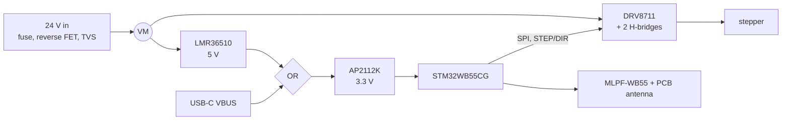

# stepper-ble

A 24 V stepper-motor driver with Bluetooth LE: TI DRV8711 with eight external N-FETs, ST STM32WB55CG with a PCB
antenna. It is this repository's worked example, designed end to end with the `hardware-design` skills, so every
claim in the skills can be checked against a public board.

- KiCad 10, JLCPCB 4-layer (SIG/GND/GND/SIG), 80 x 60 mm, 102 parts, 44 BOM lines, about $36 per board in parts
  (JLCPCB 1-off prices, 2026-11-22)
- Schematic, placed board, pin map, BOM and design notes; **not routed** (D-011)
- No firmware: requirements trace to decisions instead (`docs/requirements.md`)



## What each part of the flow produced

| Step | Tool (skill) | Result |
|---|---|---|
| Scaffold | `scaffold.py` (hardware-project) | this repo's layout, AGENTS.md, plan, reviewer agent |
| Parts | JLCPCB parts search, datasheets | every BOM line with LCSC + MPN, in stock for 5 boards (`jlc_stock.py`) |
| Project library | `scripts/make_library.py` | DRV8711 and MLPF-WB55-01E3 symbols transcribed from SLVSC40H and DS12804; two project footprints |
| Schematic | `schgen.py build / check` (schematic-capture) | 5 sheets, 102 parts, 72 nets; KiCad's netlist matches the intended one; ERC 0 |
| Net classes | `netclasses.py assign / apply / check` (pcb-copper) | 72 nets in 13 standard classes; PASS |
| Board | `scripts/make_board.py` | outline, 35 locked anchors (D-007), parts parked, zones |
| Placement | `place.py optimize` (pcb-placement) | 3 seeds, the best refined: valid, 1349 mm ratsnest, 202 crossings; assembly gate passes with `--enforce` |
| Pins | `pins.py assign / check` | 17 MCU functions on pins; converged after three passes, frozen (D-008) |
| Fab rules | `pcb_rules.py apply / check` (pcb-design-rules) | JLCPCB rules, teardrops, stack-up; 0 shorts, 0 clearance errors; fails only on the unjoined pours (expected, D-011) |
| Review | `review.py` (design-review) | 0 BLOCKER, 2 MAJOR (both from being unrouted), 10 MINOR, 11 NOTE: below |
| Traceability | `trace.py` | 12 requirements, 11 decisions; PASS |

### What the tools caught that would have shipped otherwise

- **KiCad's own footprint below the fab's minimum.** The TI SWRA117D antenna in KiCad's library has a 0.10 mm
  annular ring; JLCPCB needs 0.15 mm (D-006).
- **Vendor land patterns against the 30 V clearance.** The DRV8711's 0.5 mm pitch and the FET's gate pad can't meet
  IPC-2221C A7; the exception is scoped to those pads and recorded (D-005).
- **The NTC placed by the MCU.** It measures the FETs, but its only signal net goes to the ADC, so the optimizer put it
  0.4 mm from the QFN, which is also inside JLCPCB's assembly spacing (D-007).
- **Wrong antenna.** The Pulse W3011 looked right in a parts search; its datasheet says 1.575 GHz GNSS (D-004).

### Open review findings

From `review.py` on the placed board. The owner fixes or accepts each one before routing.

| Finding | Status |
|---|---|
| DRC unconnected items; VM and GND_IN pours not joined | expected until routed (D-011) |
| No ground stitching vias | routing step |
| U401 pin 20 (VDD) 6.8 mm from its nearest capacitor (limit 6 mm) | open: move C402 at routing |
| 50 V capacitors at 30 V (C202, C206, C207, C305, C306, C307) | open: check each DC-bias curve |
| USB CC lines and the TC2030 have no ESD part | accepted: CC is 5.1 kohm to ground; TC2030 is a bench connector |
| 15 supply nets without a test point | open (requirements, open items) |

## Reproduce it

Needs KiCad 10 (`kicad-cli` and its Python module, for `make_board.py` only), Python 3.10+ with the repository's
`requirements.txt`. From this folder, with `HW=../../plugins/hardware-design/skills`:

```bash
python3 scripts/make_library.py                                    # project symbols and footprints
python3 $HW/schematic-capture/scripts/schgen.py build scripts/schgen/config.py
python3 $HW/schematic-capture/scripts/schgen.py check scripts/schgen/config.py
python3 $HW/pcb-copper/scripts/netclasses.py assign hardware/stepper-ble/stepper-ble.kicad_pro
python3 $HW/pcb-copper/scripts/netclasses.py apply hardware/stepper-ble/stepper-ble.kicad_pro
python3 scripts/make_board.py update                                # nets from the schematic, nothing moves
python3 scripts/make_board.py zones                                 # planes, pours, antenna keep-outs
python3 $HW/pcb-design-rules/scripts/pcb_rules.py check hardware/stepper-ble/stepper-ble.kicad_pcb --allow-unrouted \
        --gate zone_islands=2                                      # the two pours routing will join (D-011)
python3 $HW/pcb-copper/scripts/netclasses.py check hardware/stepper-ble/stepper-ble.kicad_pcb
python3 $HW/pcb-placement/scripts/place.py gate hardware/stepper-ble/stepper-ble.kicad_pcb --enforce \
        --baseline hardware/stepper-ble/placement-baseline.json
python3 $HW/pcb-placement/scripts/pins.py check hardware/stepper-ble/stepper-ble.kicad_pcb --mcu U401 --needs pin-data/pin-needs.txt
python3 $HW/schematic-capture/scripts/library_check.py hardware/stepper-ble/stepper-ble.kicad_pcb
python3 $HW/design-review/scripts/review.py hardware/stepper-ble --voltage VM=30 --voltage VIN_RAW=30
```

From scratch: delete `stepper-ble.kicad_pcb`, then `make_board.py create`, `zones`, `place.py optimize` (try
`--seed 1..3`), `pins.py assign --out pin-data/pinmap.txt`, rebuild the schematic, `make_board.py update`, and
`place.py optimize --refine`. CI runs the commands above on every pull request (`.github/workflows/ci.yml`,
job `example-board`).

## Not checked

- No simulation suite yet (`circuit-simulation`); the input-protection and buck numbers are datasheet values.
- The antenna is untuned: SWRA117D was designed on another stack-up (ASSUMPTION in the RF sheet).
- KiCad's GUI was never opened on this board; everything above ran headless on KiCad 10.0.8 (Linux).
